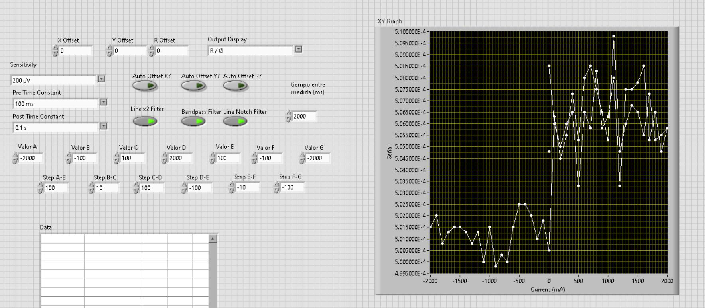
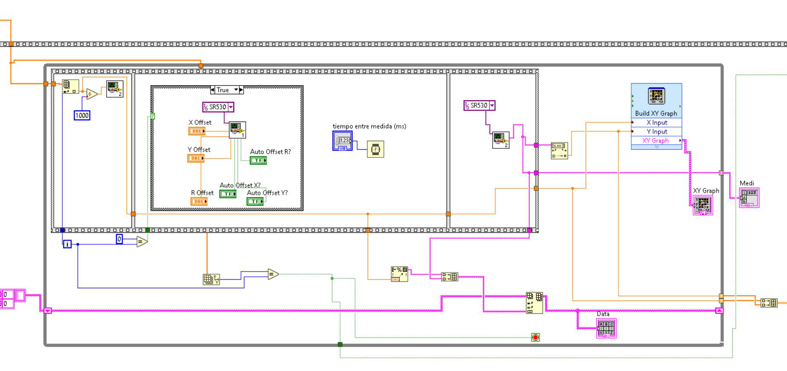
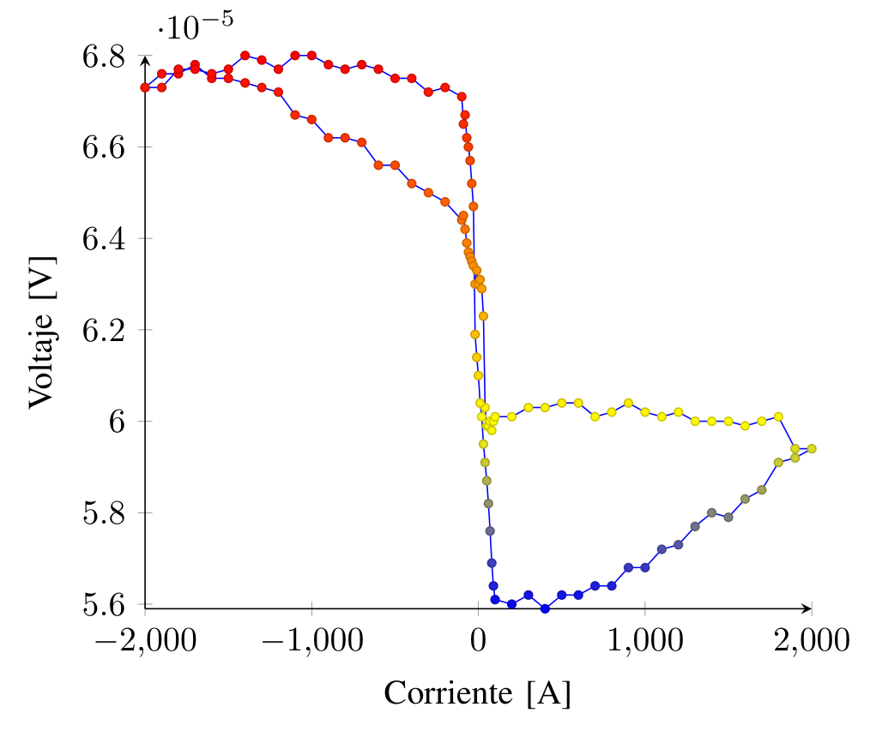

Participé en el proyecto experimental descrito en el informe **«Efecto Kerr Magneto-Óptico»**, realizado con Vicente Jasen Serón en el laboratorio de spintrónica de la Pontificia Universidad Católica de Chile durante el segundo semestre de 2022.

## Contexto y objetivo

El trabajo buscó observar el efecto magnetoóptico Kerr longitudinal en una película de CoFeB de 30 nm, mediante cambios en la señal de luz reflejada durante un barrido de corriente aplicado a las bobinas. El montaje incluyó un láser He–Ne, componentes ópticos, fotodetector y amplificador lock-in SR530.

## Técnicas y herramientas

El informe describe la alineación óptica del montaje y el uso de **LabVIEW** para controlar la secuencia experimental y adquirir las mediciones. Las capturas siguientes proceden del programa documentado en el informe.

::: {.kerr-figure-grid}
{fig-alt="Panel de control en LabVIEW usado para la secuencia de mediciones."}

[Ver panel de LabVIEW en tamaño original](../../assets/proyectos/kerr/kerr-labview-panel.png)

{fig-alt="Diagrama de bloques de LabVIEW incluido en el informe del experimento."}

[Ver diagrama de LabVIEW en tamaño original](../../assets/proyectos/kerr/kerr-labview-diagrama.png)
:::

## Resultados y alcance

El informe presenta curvas experimentales y analiza su sensibilidad al ruido, a la alineación óptica, a la posición de la muestra y al ajuste de los polarizadores. La figura muestra una de esas mediciones; el voltaje del detector se presenta como señal medida, sin convertirlo en magnetización cuantitativa.

{fig-alt="Curva experimental del gráfico 4 del informe Kerr, con voltaje frente a corriente y ramas diferenciadas por colores; se conservan los ejes originales."}

[Ver curva en tamaño original](../../assets/proyectos/kerr/kerr-histeresis-grafico-4.png)

El procedimiento expresa el barrido en mA mientras el gráfico rotula el eje como «Corriente [A]». Por esa discrepancia de unidades, no se infieren magnitudes de la curva. El informe también indica que no se determinó cómo influye exactamente el posicionamiento de la muestra en la visibilidad del efecto.

## Mi participación

Participación en el trabajo experimental y en el informe conjunto. El documento acredita a ambos autores y no desglosa tareas individuales.

## Informe original

Informe de Vicente Jasen Serón y Nicolás Ulloa Gatica, Pontificia Universidad Católica de Chile, segundo semestre de 2022 (6 páginas).

<a class="button-link" href="../../downloads/kerr/efecto-kerr-informe.pdf">Ver informe PDF</a><a class="button-link" href="../../downloads/kerr/efecto-kerr-informe.pdf" download="efecto-kerr-informe.pdf">Descargar informe PDF</a>

