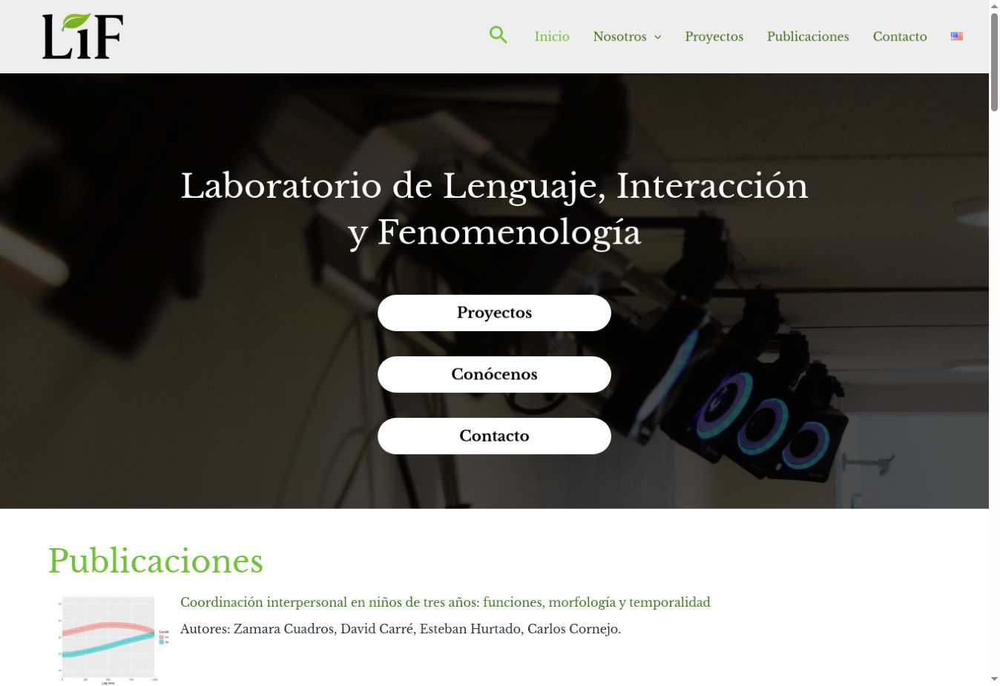

Participé en el desarrollo del sitio web institucional del Laboratorio de Lenguaje, Interacción y Fenomenología de la Pontificia Universidad Católica de Chile. El sitio reúne información sobre el laboratorio, su equipo y su actividad académica, y ofrece un punto de acceso a sus proyectos, publicaciones y contacto.

## Contexto y objetivo

Laboratorio de Lenguaje, Interacción y Fenomenología, Pontificia Universidad Católica de Chile.

Reunir y hacer accesible la información institucional y la actividad académica del laboratorio.

## Mi aporte

Participación en el desarrollo del sitio institucional.

## Herramientas

WordPress.

## Resultado

Sitio web público con secciones de equipo, proyectos, publicaciones y contacto.

## Imágenes del proyecto

{fig-alt="Portada del sitio del LIF, con navegación, título institucional y accesos a proyectos y contacto."}

Captura del [sitio institucional del LIF](https://liflab.cl/).

## Enlaces

- [Visitar sitio](https://liflab.cl/).
