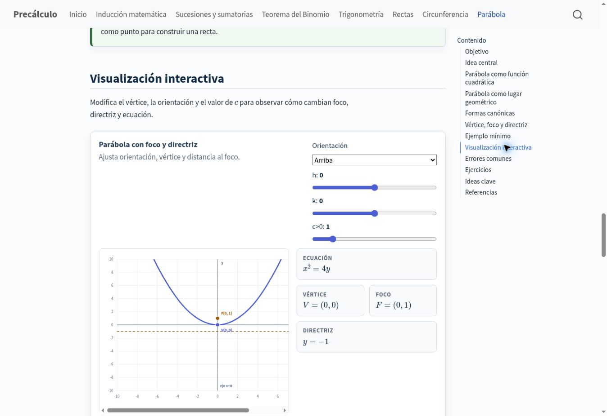

Creé un sitio de consulta de precálculo que combina definiciones, ejemplos, ejercicios y visualizaciones interactivas. Sus siete temas cubren inducción matemática, sucesiones y sumatorias, teorema del binomio, trigonometría, rectas, circunferencia y parábola. Las visualizaciones permiten explorar relaciones geométricas, como las coordenadas en el círculo unitario o la relación entre el foco y la directriz de una parábola.

## Contexto y objetivo

Recurso educativo personal de apoyo al estudio autónomo.

Integrar explicaciones, ejemplos, ejercicios y exploraciones geométricas interactivas.

## Mi aporte

Desarrollo del recurso educativo y su sitio web.

## Herramientas

Quarto, JavaScript.

## Resultado

Sitio público con siete temas y visualizaciones interactivas del círculo unitario y la parábola, entre otros contenidos.

## Imágenes del proyecto

{fig-alt="Visualización del círculo unitario a 45 grados con proyecciones de seno y coseno y control de ángulo."}

{fig-alt="Aplicación de parábola con orientación, vértice, foco, directriz y controles interactivos."}

## Enlaces

- [Visitar sitio](https://ngulloa.github.io/Precalculo/).
- [Repositorio](https://github.com/ngulloa/Precalculo).
