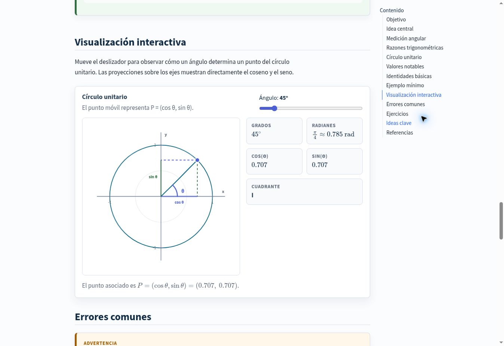
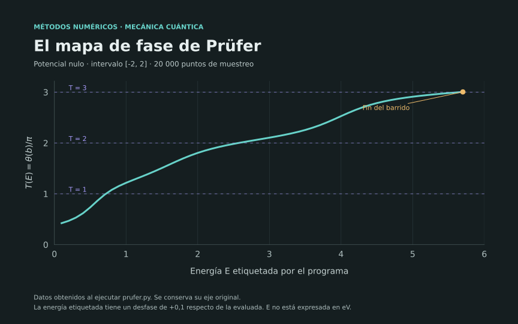
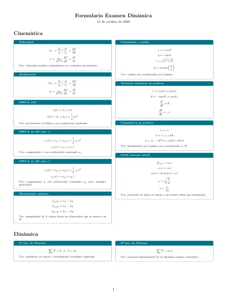

Realizo clases de apoyo universitario en matemática, física, programación y computación. Aquí comparto recursos que he desarrollado para apoyar el aprendizaje y la consulta autónoma.

::: {.resource-grid aria-label="Catálogo de recursos educativos"}

::: {.resource-card}
{.resource-card-image fig-alt="Visualización interactiva del círculo unitario con proyecciones de seno y coseno."}

## Precálculo interactivo

Explicaciones, ejemplos, ejercicios y visualizaciones sobre inducción, sucesiones y sumatorias, teorema del binomio, trigonometría, rectas, circunferencia y parábola.

::: {.resource-actions}
[Abrir Precálculo interactivo](https://ngulloa.github.io/Precalculo/)

[Ver ficha de Precálculo](../projects/precalculo/index.qmd)
:::
:::

::: {.resource-card}
{.resource-card-image fig-alt="Gráfico del mapa T(E) de Prüfer para potencial nulo en un intervalo finito; conserva sus ejes y etiquetas."}

## Métodos numéricos para mecánica cuántica

Guías de Prüfer y Shooting con implementaciones en Python, realizadas con orientación del profesor Rafael Benguria Donoso.

::: {.resource-actions}
[Guía original de Prüfer (PDF)](../downloads/metodos-numericos/metodo_de_prufer.pdf)

[Guía original de Shooting (PDF)](../downloads/metodos-numericos/metodo_de_shooting.pdf)

[Ver ficha y límites de los gráficos](../projects/metodos-numericos-qm/index.qmd)
:::
:::

::: {.resource-card .resource-card--secondary}
```{=html}

```

## [Dinámica](dinamica/index.qmd)

18 PDF de apuntes, ejercicios y un formulario de consulta, organizados en cuatro temáticas.

::: {.resource-actions}
[Ver materiales de Dinámica](dinamica/index.qmd)
:::
:::

:::

## Clases de apoyo

Para conversar sobre clases de apoyo universitario, puedes escribirme a [ngulloa@uc.cl](mailto:ngulloa@uc.cl).
